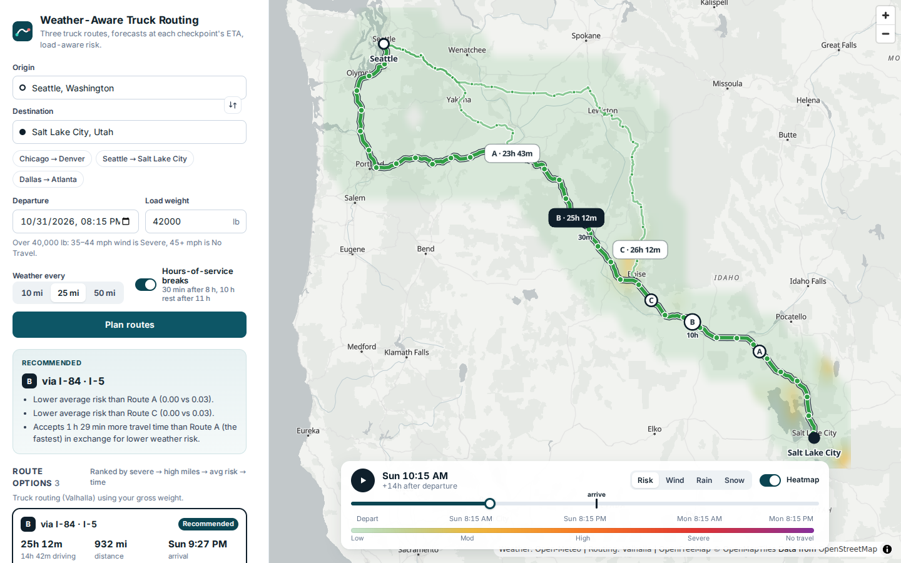
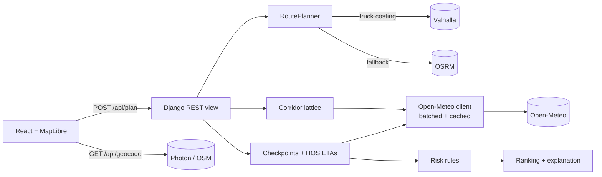

# Weather-Aware Truck Routing

A React + Django app that helps a truck driver pick the safest route. It weighs weather at the
time the truck will actually be there, the load weight, and travel time.

- **Live app:** http://prathameshjadhav.in/weather-aware-truck-routing/ (React on GitHub Pages)
- **API:** https://weather-truck-routing.onrender.com/api/health (Django on Render's free tier; the first request after it has been idle can take up to a minute)
- **Walkthrough video:** _Loom link_



## What it does

| Requirement | How it is met |
| --- | --- |
| Origin, destination, departure, load | Autocomplete place search, departure up to 7 days ahead, and load weight from 0 to 80,000 lb. |
| 3 route options from a routing API | Valhalla's **truck** profile (uses gross weight), topped up to three distinct routes with via-point alternatives. Long trips fall back to OSRM ([details](#1-routes)). |
| Weather every 10 / 25 / 50 mi at the truck's ETA | Each checkpoint's ETA comes from per-maneuver travel times plus FMCSA hours-of-service breaks. Open-Meteo hourly forecasts are read at that exact instant. |
| Risk from the risk/load rules | A direct encoding of the spec table plus the load rules, with explicit boundary handling and table-driven tests. |
| Recommend the best route | Ranked in the spec's order: fewest Severe miles, then fewest High miles, then lowest average risk, then shortest travel time. No-Travel miles act as a gate in front of that order. Each recommendation comes with a plain-English reason. |
| Routes, checkpoints, risk, ETAs, summaries on a map | Every route is colored by risk segment. Checkpoint dots have forecast popups, and HOS stops and route labels are drawn on the map. The sidebar has route cards and a checkpoint timeline. |
| Weather heatmap along the corridor, 0–48 h slider | A corridor-shaped forecast lattice. Each frame is interpolated in space and time and drawn on the GPU. Playing the slider moves each route's truck. |

## Architecture



The backend has one app, `planner`, and keeps pure logic apart from I/O:

```
backend/planner/
  domain/        pure, fully unit-tested logic (no I/O)
    geo.py           RouteLine: polyline with cumulative distance and drive time per vertex
    hos.py           hours-of-service schedule (drive time <-> wall-clock time)
    checkpoints.py   sampling every N miles, with ETAs and the road stretch each one covers
    weather.py       hourly series and how a forecast is read at an instant
    risk.py          the risk table and load rules
    scoring.py       per-route risk profile, ranking, explanations
    corridor.py      heatmap forecast lattice around the routes
    alternatives.py  via-point candidates and route distinctness checks
  providers/     third-party APIs: routing (Valhalla/OSRM), Open-Meteo, Photon
  services/      orchestration (trip_planner.py) and JSON presenters
frontend/src/
  map/           MapView (imperative MapLibre wrapper), layers, GeoJSON builders, popups
  heatmap/       raster maths (pure, tested), colour scales, HeatmapLayer (canvas source)
  components/    form, route cards, checkpoint timeline, timeline bar
```

## How it works

### 1. Routes

- **Engine.** Valhalla with `costing: truck` and the truck's gross weight. Gross weight is the load plus a typical 35,000 lb empty tractor and 53 ft trailer, so weight-restricted roads and bridges are respected. It runs on the public FOSSGIS server and needs no key.
- **Getting three distinct routes.** Engines often return only 1–2 alternatives. When that happens, the planner asks for routes forced through via points. These sit either side of the fastest route's midpoint, offset by 15–30% of the trip length, and are snapped to primary roads or bigger. A candidate is kept only if:
  - it shares ≤ 85% of its length with every route already chosen,
  - it takes ≤ 1.6× the fastest route's time,
  - it has no out-and-back spur.
- **One engine per plan,** so travel times are comparable when ranking. The public Valhalla server rejects requests that span more than 1,500 km in a straight line. For those trips, or when Valhalla can't produce three distinct routes, the whole plan uses OSRM (car profile), and the UI says so. Set `VALHALLA_URL`/`VALHALLA_MAX_KM=0` to use an unrestricted Valhalla instead, such as a self-hosted one or Stadia Maps.

### 2. Checkpoints and ETAs

- **Where.** A checkpoint at mile 0, every 10, 25 or 50 miles, and at the destination.
- **Drive time.** Driving time at each checkpoint comes from the engine's per-maneuver times, spread over the maneuver's length. It is not total time × fraction of distance, so a slow city section doesn't skew highway ETAs.
- **Wall-clock time (HOS toggle).** On by default, using FMCSA property-carrying limits: a 30-min break after 8 h of driving, and a 10-h rest after 11 h. Weather is sampled at the wall-clock arrival time, so a 1,000-mile trip correctly meets tomorrow morning's weather after the overnight rest.

### 3. Weather

- **Source.** Open-Meteo hourly forecasts in mph and in/hr. Many locations go in one request, and each location's series is cached for 30 minutes. Open-Meteo rejects bursts of concurrent requests, so a process-wide semaphore caps requests in flight and retries that specific 429.
- **Reading a forecast at an ETA.** Wind is instantaneous, so it is interpolated between hours. Rain, showers and snowfall are totals for the *preceding* hour, so at 13:40 the truck gets the 13:00→14:00 bucket. That bucket is directly the in/hr rate the risk table uses. Rain = `rain + showers` (liquid precipitation).

### 4. Risk rules (`domain/risk.py`)

The table's integer ranges and shared endpoints (e.g. `0.10–0.25`, `0.25–0.50`) are read as **lower bound inclusive, upper exclusive**. The exception is the top of the precipitation scale, where the spec writes "> 1.00" / "> 3.0".

| | Low | Moderate | High | Severe | No Travel |
| --- | --- | --- | --- | --- | --- |
| Wind (mph) | < 25 | [25, 35) | [35, 45) | [45, 55) | ≥ 55 |
| Rain (in/hr) | < 0.10 | [0.10, 0.25) | [0.25, 0.50) | [0.50, 1.00] | > 1.00 |
| Snow (in/hr) | < 0.5 | [0.5, 1.0) | [1.0, 2.0) | [2.0, 3.0] | > 3.0 |

- **Load rules** raise *wind* risk:
  - 45–54 mph with a load over 30,000 lb → No Travel.
  - 35–44 mph with a load over 40,000 lb → Severe.
  - The UI marks checkpoints raised this way.
- **Overall level** at a checkpoint is the worst of wind, rain and snow.
- **Wind measure.** The table uses sustained 10 m wind; gusts are shown for context.

### 5. Recommendation (`domain/scoring.py`)

- **Miles per level.** Each checkpoint stands for the road halfway to its neighbours. These stretches tile the route exactly, so "miles at level X" adds up to the route length.
- **Average risk** is the distance-weighted mean level (0 = Low … 4 = No Travel).
- **Ranking order** is lexicographic: **No-Travel miles**, then Severe miles, then High miles, then average risk, then door-to-door time (HOS included).
  - The spec doesn't mention No Travel. Reading the list literally would let a route that crosses No-Travel conditions win just because it has fewer *Severe* miles, so No-Travel goes first as a gate.
  - Miles are rounded to 0.1 and average risk to 0.01, so float noise can't decide a ranking that should fall through to travel time.
- **Explanation.** The UI states the deciding criterion against each other route, the time traded for safety, and warnings, e.g. "every option crosses No-Travel conditions — consider delaying departure".

### 6. Heatmap

- **Backend.**
  - Forecast points sit on a **global** lat/lon lattice within 20–60 mi of any route, so overlapping trips share cache entries.
  - The lattice step is the finest that keeps the corridor at ≤ 260 points. That caps weather calls at about 400 per plan, whatever the trip length.
  - Each point gets 50 hourly frames covering departure + 48 h: risk (load-adjusted), wind, rain and snow.
- **Frontend.**
  - For each slider position the frontend interpolates in time between hourly frames. It then samples the lattice bilinearly into a small canvas whose rows sit at their **Web Mercator** positions (a lat/lon grid is not linear on a Mercator map).
  - Corridor edges fade out with data coverage. MapLibre shows the canvas as a texture under the basemap labels, with GPU linear filtering.
  - A frame costs about 1.4 ms of CPU for a 636-point corridor. The canvas is uploaded only when the frame changes, so an idle map does no work.
- **Colours** change exactly at the risk-table thresholds, so the heatmap reads the same as the checkpoint chips.

### UI performance

- **The map is created once.** Each React prop maps to the cheapest MapLibre call: `setData` once per plan, `setFilter` on route selection, and `feature-state` on hover.
- **Scrubbing or playing the slider** updates only three truck points and the heatmap texture. The sidebar is memoised and doesn't re-render during playback, which runs on `requestAnimationFrame` with real frame deltas.
- **Bundle.** MapLibre ships as its own long-cached chunk; JSON responses are gzipped; hashed assets are served `immutable`.

## API

`POST /api/plan`

```json
{
  "origin": {"label": "Chicago, Illinois", "lat": 41.8781, "lon": -87.6298},
  "destination": {"label": "Denver, Colorado", "lat": 39.7392, "lon": -104.9903},
  "departure": "2026-11-02T14:00:00Z",
  "load_weight_lb": 42000,
  "interval_miles": 25,
  "hos": true
}
```

The response contains:

- `routes[]`, each with:
  - `distance_mi`, `drive_time_s`, `trip_time_s`, `arrival`, `rank`, `recommended`
  - `summary`: miles per level, average and worst risk
  - `checkpoints[]`: mile, ETA, weather, risk and its drivers
  - `risk_segments[]`, `stops[]`, `geometry`
  - `track`: truck position every 15 min for the slider
- `recommendation`: `route_id`, `reasons`, `warnings`
- `routing`: engine and profile used
- `heatmap`: lattice, corridor cells, 50 frames × 4 metrics

`GET /api/geocode?q=denver` returns place suggestions. `GET /api/health` is the liveness check. Validation errors return 400 with field messages; upstream failures return 502, 503 (rate limited) or 422 (no route).

## Running locally

Requires Python 3.12+ and Node 22+.

```bash
# API on :8000
cd backend
python -m venv .venv && source .venv/bin/activate
pip install -r requirements-dev.txt
DJANGO_DEBUG=1 python manage.py runserver

# UI on :5173 (proxies /api to :8000)
cd frontend
npm ci
npm run dev
```

Or as one container that serves both: `docker build -t truck-routing . && docker run -p 8000:8000 -e DJANGO_SECRET_KEY=dev truck-routing`.

### Tests

```bash
cd backend && pytest && ruff check .          # 138 tests: risk bands, load rules, HOS, ETAs, ranking, providers, API
cd frontend && npm test && npm run lint && npm run build
```

CI (`.github/workflows/ci.yml`) runs all of the above on every push.

## Deployment

- **Frontend → GitHub Pages.** `.github/workflows/pages.yml` builds with `VITE_BASE_PATH=/<repo>/` and `VITE_API_BASE_URL` (repository variable `API_BASE_URL`, defaulting to the Render URL).
- **API → Render.** `render.yaml` is a one-click Blueprint ([deploy](https://render.com/deploy?repo=https://github.com/lollinng/weather-aware-truck-routing)) that builds the Dockerfile. The same container also serves the UI at its own URL.

| Env var | Default | Purpose |
| --- | --- | --- |
| `DJANGO_SECRET_KEY` | — (required unless `DJANGO_DEBUG=1`) | Django secret |
| `DJANGO_ALLOWED_HOSTS` | `localhost,127.0.0.1` | Comma-separated hosts (`.onrender.com` on Render) |
| `CORS_ALLOWED_ORIGINS` | the GitHub Pages origins | Origins of a separately hosted frontend |
| `VALHALLA_URL` / `VALHALLA_API_KEY` / `VALHALLA_MAX_KM` | public FOSSGIS server / — / `1500` | Truck routing engine and its request range (`0` = unlimited) |
| `OSRM_URL` | public demo server | Fallback routing |
| `OPEN_METEO_API_KEY` | — | Use Open-Meteo's commercial endpoint (higher limits) |
| `PLAN_RATE_LIMIT` / `GEOCODE_RATE_LIMIT` | `12/min` / `90/min` | Per-IP throttles that protect upstream quotas |

## Assumptions and limitations

- **Free public services.**
  - Valhalla/FOSSGIS caps requests at 1,500 km, which is why long trips use OSRM's car profile.
  - Open-Meteo's free tier is non-commercial and rate limited. Each plan costs a few hundred location-calls, and caching makes repeat plans nearly free.
  - All of these can be swapped for keyed or self-hosted endpoints through env vars.
- **Weather.** The risk table covers wind, rain and snow only. Icing (freezing rain or fog) is flagged in the popup but not scored. Forecasts are model output at a point; the corridor heatmap is a visual aid, while risk scoring uses the exact checkpoint forecasts.
- **HOS.** The model ignores on-duty time for loading and unloading, and the 70-hour/8-day cycle.
- **Truck-specific travel times** come from the routing engine; no extra speed governor is applied.

## What I would do next

- Suggest a later departure when every route crosses No-Travel conditions, by re-running the ranking at +2/+4/+6 h.
- Stream progress (routing → forecasts) with server-sent events instead of one blocking request.
- Use a shared cache (Redis) so several workers or instances share forecasts.
